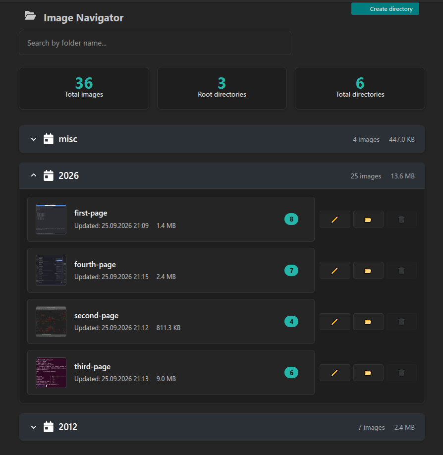

# wagtail-image-directories

**Directory-based image storage and a visual Image Navigator for Wagtail.** This package adds `year` and `slug` metadata to your configured Wagtail image model, organizes newly uploaded originals under `MEDIA_ROOT/images/<year>/<slug>/`, and provides an admin interface for browsing, uploading, moving, merging, renaming, and deleting image groups.

It is intended for sites with large media libraries where a flat directory is difficult to maintain. It does not generate image renditions by itself and it does not decide which rendition sizes your project should create.

[English](README.md) · [Русский](README.ru.md) · [Deutsch](README.de.md) · [Español](README.es.md) · [Français](README.fr.md) · [Italiano](README.it.md) · [Português (Brasil)](README.pt-BR.md) · [Nederlands](README.nl.md) · [Polski](README.pl.md) · [Türkçe](README.tr.md) · [简体中文](README.zh-CN.md) · [日本語](README.ja.md) · [한국어](README.ko.md)



## What it provides

- **Predictable paths:** new image originals are stored below `images/<year>/<slug>/`. An empty slug stores the image in `images/<year>/`.
- **Image Navigator:** directory browsing with counts, approximate stored size, latest-image information, and pagination.
- **Uploads into a chosen directory:** the Navigator accepts multiple files and validates the count, byte size, and image decoding/pixel count before handing them to Wagtail.
- **Directory operations:** create, rename, merge, and delete empty directory records; bulk move/delete operations check Wagtail image permissions.
- **Admin previews:** directory cards use a real 150×150 rendition and read `file_size` from the database to avoid storage-size I/O on each card.
- **Wagtail Collections:** the directory tree is mirrored into Wagtail Collections so existing collection permissions can still be used.
- **Configurable safety limits:** control upload size, batch size, pixel limits, and physical file movement with Django settings.

## Audit/release status

This source bundle prepares version `0.2.0` for a possible next release. Static syntax/package checks have been run, but a full Django/Wagtail integration suite has not run in the bundle build environment. Do not upload to PyPI until the release checklist in `../../04-docs/UPGRADE_AND_RELEASE.md` is complete.

## Requirements and compatibility

The package metadata declares `wagtail>=6.0`. It depends on the configured Wagtail image model and a writable media storage backend. The supplied source archive does not include an automated compatibility matrix for every Django/Wagtail version; test your exact versions and storage backend before deployment.

## Installation

```bash
pip install wagtail-image-directories
```

To install **the candidate source in this bundle** (rather than the already-published PyPI release), run from this package directory:

```bash
python -m pip install .
# For editable development instead:
python -m pip install -e .
```

`pip install wagtail-image-directories` selects the version currently published on PyPI. The candidate version shown in `pyproject.toml` is not published by this archive operation; publish it only after the release checklist in `../../04-docs/UPGRADE_AND_RELEASE.md` passes.


Add the app after Wagtail's image app has been installed:

```python
INSTALLED_APPS = [
    # ... Django and Wagtail apps ...
    "wagtail.images",
    "wagtail_image_directories",
    # ... your app containing the concrete image model ...
]
```

The package provides an **abstract** image model. Point Wagtail to a concrete project model derived from it. Example (replace `media` with your app label):

```python
from django.db import models
from wagtail.images.models import AbstractRendition
from wagtail_image_directories.models import AbstractDirectoryImage

class CustomImage(AbstractDirectoryImage):
    pass

class CustomRendition(AbstractRendition):
    image = models.ForeignKey(
        CustomImage,
        on_delete=models.CASCADE,
        related_name="renditions",
    )

    class Meta:
        unique_together = (("image", "filter_spec", "focal_point_key"),)
```

Configure the model paths:

```python
WAGTAILIMAGES_IMAGE_MODEL = "media.CustomImage"
WAGTAILIMAGES_RENDITION_MODEL = "media.CustomRendition"
```

Then generate and apply migrations for **both** the plugin and the app containing your concrete image model:

```bash
python manage.py makemigrations wagtail_image_directories media
python manage.py migrate
```

If your project already has a custom image/rendition model, do not replace it blindly. Adapt the inheritance and migration steps to your current model and take a database plus media backup first.

## Storage layout and existing files

New uploads use paths such as:

```text
MEDIA_ROOT/
└── images/
    └── 2026/
        └── rca-connectors/
            ├── front.png
            └── rear.png
```

The `upload_to` path controls **new files only**. A database migration does not move existing files. The model field allows a 1024-character stored path so the `images/<year>/<slug>/<filename>` prefix and a descriptive filename can fit; names can still be shortened by Django storage if the complete path exceeds the configured limit. Plan existing-file relocation separately, verify the old and new paths, and preserve a backup until you have checked the image records, renditions, page bodies, and direct URLs. Do not run a bulk relocation on production without a dry run and storage snapshot.

**Rendition/disk-quota note:** opening a directory can create one `fill-150x150` thumbnail for each image rendered on that page, unless it already exists. This avoids sending full originals to the browser, but it adds disk use (potentially one additional rendition per image over time). Count the existing renditions and available quota first. Do not remove old renditions blindly when moving originals: body HTML and other stored references can contain hard-coded rendition URLs, and the plugin does not rewrite all such references automatically.

The Navigator's upload limit defaults are 50 MiB per file, 30 files per batch, and Pillow's configured maximum image pixel count (with a fallback safety limit). They can be adjusted in settings:

```python
WAGTAIL_IMAGE_DIRECTORIES_MAX_UPLOAD_SIZE = 50 * 1024 * 1024
WAGTAIL_IMAGE_DIRECTORIES_MAX_UPLOADS = 30
WAGTAIL_IMAGE_DIRECTORIES_MAX_PIXELS = 89_478_485
WAGTAIL_IMAGE_DIRECTORIES_MOVE_FILES = True
```

Set `WAGTAIL_IMAGE_DIRECTORIES_MOVE_FILES = False` only when your storage/operations design deliberately manages paths elsewhere. In that mode, directory metadata and physical paths may no longer match; document the consequences and test your storage adapter.

## Permissions and operations

Navigator views require Wagtail image permissions. Directory listings are derived from images the current user can choose, and upload/move/delete actions check the relevant `add`, `change`, `choose`, or `delete` permission. Test these operations with at least one restricted-Collection user, not only a superuser.

Moving files is a storage operation as well as a database operation. A storage backend cannot always roll file changes back with a database transaction. The code schedules moves after transaction commit and favors leaving a duplicate file over leaving a database record pointing to a missing file. Monitor logs and orphan files after large batch operations.

## Renditions and disk quotas

This package organizes **original image files**. Wagtail renditions are separate files controlled by your image-model/rendition configuration and by calls to `image.get_rendition()` / template `` tags. If your site has tens of thousands of pages and close to one hundred thousand originals, unrestricted arbitrary crop specifications can multiply storage use dramatically. The navigator now uses `fill-150x150` cards, which can create one additional rendition per viewed image; this is a deliberate network-versus-disk trade-off, not a zero-storage optimization. Keep your rendition policy explicit, allow only the sizes your templates actually use, and measure disk usage before enabling new filters. See the bundle's `docs/IMAGE_STORAGE_AND_RENDITIONS.md` for the companion project's bounded-rendition design.

## Recommended combinations

- **Use with `wagtail-prose-editor-images`** when editors insert Wagtail-managed images from the Prose editor and you want files to be organized with directory metadata.
- **Use with `wagtail-desktop-publisher`** if articles are authored in Markdown on a desktop and images should be uploaded into the same `year/slug` structure. That package requires its publisher image endpoint or an equivalent integration on the target site.
- This package is independent of the comments and forum packages.

## Troubleshooting checklist

1. Confirm `WAGTAILIMAGES_IMAGE_MODEL` points to your concrete subclass.
2. Run `showmigrations wagtail_image_directories <your-image-app>` and verify every intended migration is applied.
3. Upload one small image through the Navigator and one through the normal Wagtail chooser/API, then inspect the stored names.
4. Test with a user restricted to a Wagtail Collection.
5. Verify backups and URLs before moving existing files.

## License and support

MIT. Source and issue tracker: [GitHub](https://github.com/vovansrnd/wagtail-image-directories). Please include Django, Wagtail, Python, database, and storage-backend versions in bug reports. Do not include credentials or private image URLs.


## Actual upload path and migrations

The `file` field on `AbstractDirectoryImage` explicitly uses `directory_image_upload_to`, so normal Wagtail uploads made through this concrete model use `images/<year>/<slug>/<filename>`. Generate and apply the migration for your concrete image model when upgrading. The `wagtail_image_directories.0004_allow_unicode_directory_slug` and core migrations `blog.0034_alter_customimage_file_max_length` / `blog.0035_customimage_path_length_and_unicode_slug` change field metadata and the destination for **new** uploads only; they do not relocate existing originals. Verify the model and migration state in staging before using the Navigator or the publisher endpoint.

The core project in the companion bundle also includes a `CustomImage.get_rendition()` allowlist that reuses the original file for a small set of known specifications. That is a separate project-specific disk-quota optimization, not a general Wagtail guarantee. Reusing the original avoids extra rendition files but does not produce resized/cropped image bytes; check the browser's delivered dimensions and data transfer before adopting the technique on another site.
